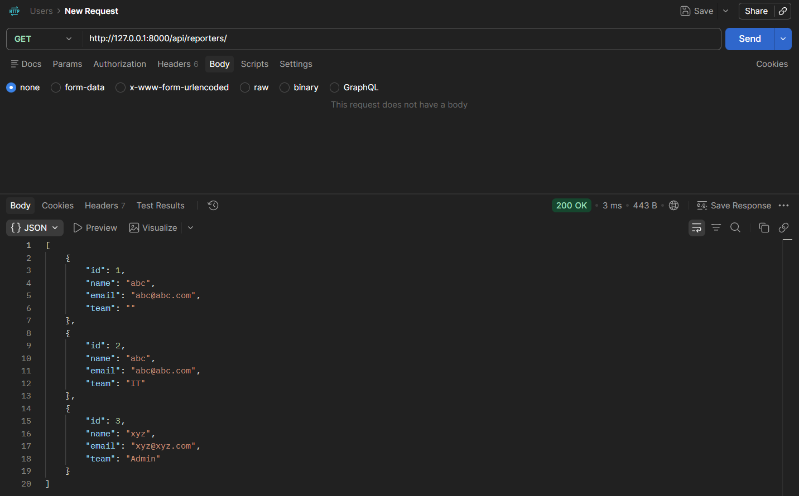
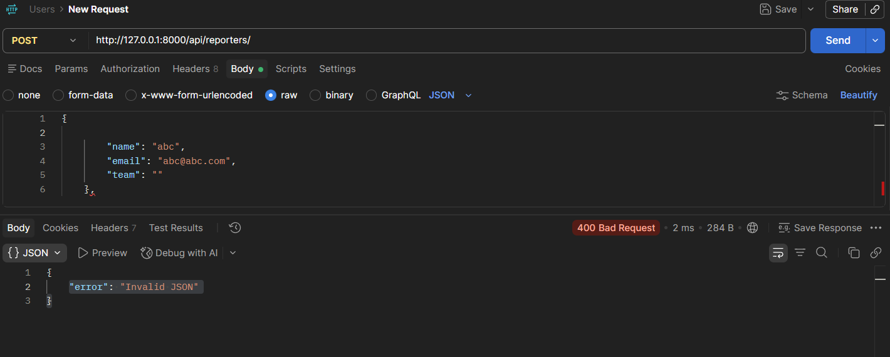

# DevTrack

A minimal Django API for tracking engineering issues. Data is persisted in
`reporters.json` and `issues.json`.

## Run the project

From the project root, install the dependencies and start Django's development
server:

```text
python -m pip install -r requirements.txt
python manage.py runserver
```

The API is then available at `http://127.0.0.1:8000/`. Data is stored in the
JSON files in the project root, so no database setup or migrations are needed.

## API endpoints

All POST requests must use `Content-Type: application/json`.

### Reporters

- `POST /api/reporters/` creates a reporter. Required fields are `name`,
  `email`, and `team`. The response contains the new reporter and returns
  `201 Created`.
- `GET /api/reporters/` returns all reporters.
- `GET /api/reporters/?id=1` returns the reporter with ID `1`, or a `404 Not
  Found` response when it does not exist.

Example request body:

```json
{
  "name": "Ada Lovelace",
  "email": "ada@example.com",
  "team": "backend"
}
```

### Issues

- `POST /api/issues/` creates an issue linked to an existing reporter.
  Required fields are `title`, `description`, `status`, `priority`, and
  `reporter_id`. The response includes a priority-specific `message` and
  returns `201 Created`.
- `GET /api/issues/` returns all issues.
- `GET /api/issues/?id=1` returns the issue with ID `1`, or a `404 Not Found`
  response when it does not exist.
- `GET /api/issues/?status=open` returns only issues whose status is `open`.
  Supported statuses are `open`, `in_progress`, `resolved`, and `closed`.

Supported priorities are `low`, `medium`, `high`, and `critical`.

## Design decision

I chose JSON files instead of Django database models for persistence because
the brief explicitly requires `issues.json` and `reporters.json`. This keeps
the project simple to run and makes the stored records easy to inspect during
API testing, while the Python entity classes still provide the requested
validation and OOP behavior.

## Postman screenshot
Pass


Fail
